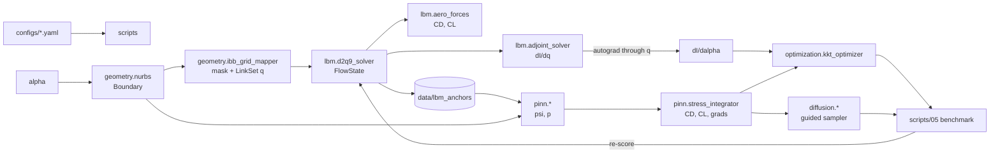

# Architecture

## Goal

One codebase that turns a shape vector `alpha` into drag and lift and their gradients, by three interchangeable routes (adjoint LBM, MLP-PINN, Transformer-PINN), plus a generative route (guided diffusion) that produces `alpha` directly from a target. Every route is scored by the same LBM.

## Data flow



## Layers and dependency rules

| Layer | Package | May import | Must not import |
|---|---|---|---|
| Core | `aeroshape.core` | torch, numpy, yaml | anything else in `aeroshape` |
| Geometry | `aeroshape.geometry` | core; `aeroshape.lbm.lattice` only (D2Q9 constants, pure data) | the rest of lbm, pinn, diffusion, optimization |
| LBM | `aeroshape.lbm` | core, geometry | pinn, diffusion, optimization |
| PINN | `aeroshape.pinn` | core, geometry | lbm (reads anchor files, not solver code), diffusion |
| Diffusion | `aeroshape.diffusion` | core, geometry, pinn | lbm, optimization |
| Optimization | `aeroshape.optimization` | core, geometry; evaluators import lbm and pinn | diffusion |
| Visualization | `aeroshape.visualization` | everything (read-only use) | — |
| Scripts | `scripts/` | everything | — (nothing imports scripts) |

Enforced by a test that parses imports (`tests/test_layering.py`).

## The `Evaluator` seam

The optimizer and the benchmark never know which solver they use. They call:

```python
class Evaluator(Protocol):
    def evaluate(self, alpha: Tensor, cond: Condition) -> EvalResult: ...
# EvalResult: cd, cl (0-dim tensors), dcd_dalpha, dcl_dalpha ([k] tensors), wall_s, extras: dict
```

Implementations: `AdjointLBMEvaluator`, `PINNEvaluator(model)`, and `LBMScoreEvaluator` (forward only, no gradient; used by the benchmark to re-score).

## Runtime lifecycle (one optimization run)

1. `load_config(case, tier, overrides)` → `Config`.
2. `device = get_device(cfg)`, `seed_everything(cfg.seed)`.
3. `nurbs = NURBSAirfoil(cfg.geometry)`, `alpha0 = start_shape(cfg)`.
4. `evaluator = build_evaluator(cfg)`.
5. Loop cycles: `res = evaluator.evaluate(alpha, cond)` → `optimizer.step(res)` → log → checkpoint `alpha` and history.
6. `LBMScoreEvaluator` on the final `alpha` → write `results.json`.

## Design principles

- **Pure functions for physics.** `step(f, links, params)` returns a new tensor; no hidden state. Makes the autograd reference adjoint trivial and keeps tests simple.
- **Batched by default where it pays.** Geometry, PINN and diffusion take a batch dimension `B`. The LBM is one shape per solve (grids are large; batching shapes would multiply memory), but the dataset script can run several solves in sequence without reallocating.
- **One source of truth for constants.** Lattice constants live in `lbm/lattice.py`; non-dimensional conversion in one function `lbm_to_nondim()`.
- **Configs, not flags in code.** Every number in this plan that a person might tune is a config key.
