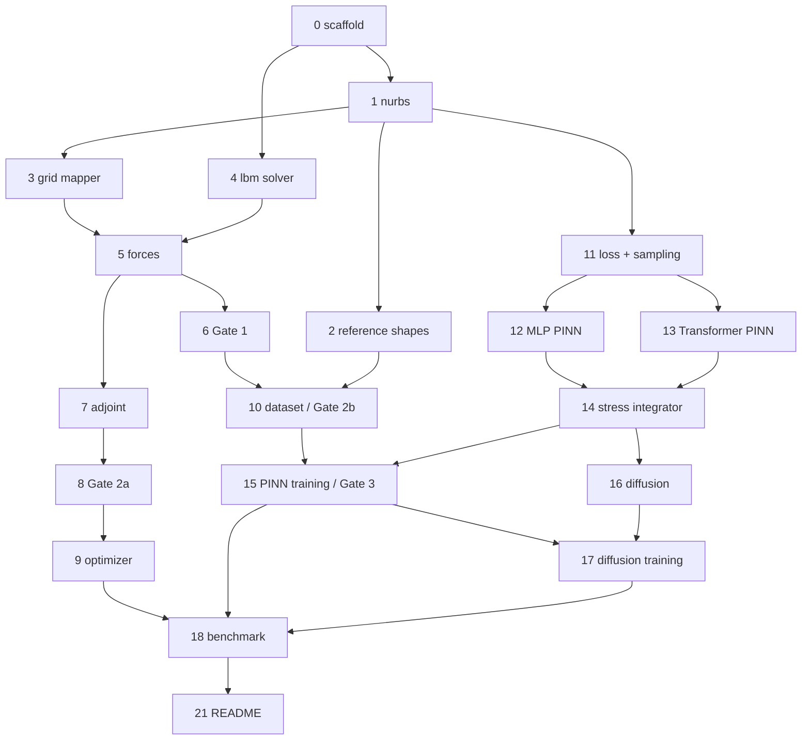

# Work packages

Each package: one Sonnet implementer, one spec doc, a fixed file list, tests first, one acceptance command. Dependencies must be **done** (accepted by the orchestrator) before dispatch.

## Dependency graph

WP 19 (plots) and WP 20 (smoke harness, CUDA check) grow alongside: the orchestrator dispatches their increments right after WP 6, 8, 10, 15, 17, 18.

## Parallel groups (≤ 3 implementers)

| Wave | Packages |
|---|---|
| A | 0 |
| B | 1, 4 |
| C | 2, 3, 11 |
| D | 5, 12, 13 |
| E | 6, 7, 14 |
| F | 8, 10, 16 |
| G | 9, 15 (training run in background), 19-increments |
| H | 17, 20-increment |
| I | 18 |
| J | 21, 22 (WP 22 can also start any time after WP 0) |

Gate order still holds: wave F's WP 10 needs Gate 1 (WP 6) passed; WP 9 needs Gate 2a (WP 8).

## Packages

| WP | Name | Files | Spec | Acceptance command | Done when |
|---|---|---|---|---|---|
| 0 | Scaffold | `pyproject.toml`, `.python-version`, `.gitignore`, `src/aeroshape/__init__.py`, `core/*`, `configs/base.yaml`, `configs/tiers/*`, `tests/conftest.py`, `tests/core/*`, `tests/test_layering.py`, `scripts/00_smoke_e2e.py` (stage skeleton), `scripts/lattice_table.py` | [repo_layout](../01_system_design/repo_layout.md), [device_and_precision](../01_system_design/device_and_precision.md), [config_and_run_tiers](../01_system_design/config_and_run_tiers.md), [data_contracts](../01_system_design/data_contracts.md) | `uv sync --extra dev && uv run pytest && uv run python scripts/lattice_table.py` | tests pass on CPU and MPS; device info printed; lattice table equals [forward_solver.md](../03_lbm/forward_solver.md) |
| 1 | NURBS | `geometry/nurbs.py`, `tests/geometry/test_nurbs.py` | [nurbs](../02_geometry/nurbs.md) | `uv run pytest tests/geometry/test_nurbs.py` | all spec tests pass |
| 2 | Reference shapes | `geometry/reference_shapes.py`, `geometry/data/rae2822.csv`, tests; `lattice_table.py --fit-report` | [reference_shapes](../02_geometry/reference_shapes.md) | `uv run pytest tests/geometry/test_reference_shapes.py && uv run python scripts/lattice_table.py --fit-report` | tests pass; cambered `k` chosen and written to case configs (orchestrator) |
| 3 | Grid mapper | `geometry/ibb_grid_mapper.py`, tests | [grid_mapping_ibb](../02_geometry/grid_mapping_ibb.md) | `uv run pytest tests/geometry/test_ibb_grid_mapper.py` | tests pass; timing target met |
| 4 | LBM solver | `lbm/lattice.py`, `lbm/d2q9_solver.py`, tests; `lattice_table.py --benchmark` | [forward_solver](../03_lbm/forward_solver.md) | `uv run pytest tests/lbm/test_d2q9_solver.py tests/lbm/test_lattice.py && uv run python scripts/lattice_table.py --benchmark --device mps` | tests pass; MLUPS recorded in `runs/perf/` and [compute_budget.md](../06_training/compute_budget.md) updated by orchestrator |
| 5 | Forces | `lbm/aero_forces.py`, tests | [forces](../03_lbm/forces.md) | `uv run pytest tests/lbm/test_aero_forces.py` | tests pass |
| 6 | Gate 1 | `scripts/01_validate_lbm_cylinder.py`, `configs/validate_cylinder.yaml`, plot functions it needs | [validation](../03_lbm/validation.md) | `uv run python scripts/01_validate_lbm_cylinder.py --tier dev --device mps` | Gate 1 table passes (or documented full-tier plan) |
| 7 | Adjoint solver | `lbm/adjoint_solver.py`, tests | [adjoint_solver](../03_lbm/adjoint_solver.md) | `uv run pytest tests/lbm/test_adjoint_solver.py -m "not slow"` | validation ladder levels 1–4 pass |
| 8 | Gate 2a | adjoint-check mode in script 01, `plot_gradient_check` | [validation](../03_lbm/validation.md) | `uv run python scripts/01_validate_lbm_cylinder.py --adjoint-check --tier dev --device cpu` | relative L2 < 2e-3 |
| 9 | Optimizer | `optimization/*`, `scripts/06_optimize_case.py`, case configs, tests | [kkt_optimizer](../05_optimization/kkt_optimizer.md) | `uv run pytest tests/optimization && uv run python scripts/06_optimize_case.py --case case1_circle_to_naca_re20 --evaluator adjoint_lbm --tier smoke` | tests pass; smoke CD non-increasing |
| 10 | Dataset | `scripts/02_generate_lbm_dataset.py`, tests | [dataset_generation](../06_training/dataset_generation.md) | `... 02_generate_lbm_dataset.py --set v1 --tier dev --device mps` | Gate 2b |
| 11 | Loss + sampling | `pinn/navier_stokes_loss.py`, `pinn/sampling.py`, `pinn/embeddings.py` (`predict_flow`, `wall_distance`), tests | [ns_loss_and_sampling](../04_models/ns_loss_and_sampling.md) | `uv run pytest tests/pinn/test_navier_stokes_loss.py tests/pinn/test_sampling.py` | tests pass (uses an analytic stand-in model) |
| 12 | MLP PINN | `pinn/mlp_pinn.py`, rest of `pinn/embeddings.py`, tests | [mlp_pinn](../04_models/mlp_pinn.md) | `uv run pytest tests/pinn/test_mlp_pinn.py tests/pinn/test_embeddings.py` | tests pass incl. Kovasznay fit |
| 13 | Transformer PINN | `pinn/transformer_pinn.py`, tests | [transformer_pinn](../04_models/transformer_pinn.md) | `uv run pytest tests/pinn/test_transformer_pinn.py` | tests pass incl. MPS higher-order check; step time recorded |
| 14 | Stress integrator | `pinn/stress_integrator.py`, tests | [stress_integrator](../04_models/stress_integrator.md) | `uv run pytest tests/pinn/test_stress_integrator.py` | tests pass |
| 15 | PINN training | `scripts/03_train_transformer_pinn.py`, `PINNEvaluator` wiring, tests | [pinn_training](../06_training/pinn_training.md) | smoke: `... --tier smoke`; then dev runs for both models (background) | Gate 3 |
| 16 | Diffusion model | `diffusion/*`, tests | [diffusion](../04_models/diffusion.md) | `uv run pytest tests/diffusion` | tests pass |
| 17 | Diffusion training | `scripts/04_train_diffusion_model.py` | [diffusion_training](../06_training/diffusion_training.md) | `... 04_train_diffusion_model.py --tier dev --device mps` | WP 17 acceptance |
| 18 | Benchmark | `scripts/05_run_4way_benchmark.py`, `LBMScoreEvaluator` | [four_way_benchmark](../08_benchmark/four_way_benchmark.md) | `... 05_run_4way_benchmark.py --tier dev --cases 1 --device mps` then cases 2–3 | results table for all 3 cases at dev tier |
| 19 | Visualization | `visualization/*`, tests | [visualization](../08_benchmark/visualization.md) | `uv run pytest tests/visualization` | every listed figure renders |
| 20 | Smoke + CUDA | `scripts/00_smoke_e2e.py` stages, `scripts/cuda_check.sh`, `scripts/compare_summary.py`, `notebooks/colab_cuda.ipynb`, `tests/fixtures/smoke_reference.json` | [e2e_mac_mini](../07_testing/e2e_mac_mini.md), [cuda_cloud_runbook](../07_testing/cuda_cloud_runbook.md) | `uv run python scripts/00_smoke_e2e.py --device mps` (Mac); `bash scripts/cuda_check.sh` (cloud) | e2e passes on CPU and MPS; cloud check passes |
| 21 | README | `README.md` | [four_way_benchmark](../08_benchmark/four_way_benchmark.md) | links and figures resolve | written from measured results only |
| 22 | Docker image | `Dockerfile` (multi-stage: `cuda` target on `nvidia/cuda:12.4.1-cudnn-runtime-ubuntu22.04` + CUDA torch; `cpu` target on `python:3.12-slim` + CPU torch), `.dockerignore` (excludes `data/`, `runs/`, `.venv/`, `graft/`), `docker/README.md` | [cuda_cloud_runbook](../07_testing/cuda_cloud_runbook.md) | `docker build --target cpu -t aeroshape:cpu . && docker run --rm aeroshape:cpu pytest -q` (Mac); `docker run --rm --gpus all aeroshape:cuda bash scripts/cuda_check.sh` (cloud) | both images build from `uv.lock`; tests pass in the CPU image; CUDA image passes the cloud check. Note: Docker on macOS has no Metal/MPS access, so Mac GPU runs stay native via `uv` |

## Follow-ups found during implementation

| # | Found in | Issue | Planned fix | Blocks |
|---|---|---|---|---|
| F1 ✅ | WP 9 | Re 1000 smoke run (N = 24, TRT, time-averaged, domain 10×5) gives NaN in the forward solve, sponge on or off | LBM stability investigation after WP 6 (TRT at Re 100 is exercised there): check tau 0.504 at N = 24, inlet/outlet with shedding, sponge, averaging path; try N = 48 | Cases 2–3, dataset v2 |
| F2 | WP 9 | Steady adjoint is slow (~28 s vs ~1 s forward on MPS, smoke) and hits its iteration cap; plain fixed-point iteration needs ~10⁴ sweeps | Accelerate the steady adjoint (e.g. GMRES / Anderson on the linear fixed point, or warm start F* from the previous cycle) | Benchmark wall-clock of method 1 |
| F3 | WP 9 | Optimizer warm-starts trial forwards by calling private `_setup` / `_forward` in `adjoint_solver.py`; `lbm_value_and_grad` has no `f0` | Add `f0` argument and return the converged `f` in `extras`; switch the evaluator to it | — (cleanup) |
| F5 ✅ | WP 6 | `run()` unsteady period detection counts zero crossings from the first record, so start-up wiggles give spurious St (0.93–1.4 vs 0.17); symmetric start never sheds at 20 × 10 without a perturbation; Re 100 at N = 10 gives NaN (tau 0.517, TRT) | LBM fix package with F1: transient inside `run()`, optional initial transverse perturbation in `init_state`, stability check | Gate 1 robustness, dataset v2 |
| F6 | F2 | Krylov (GMRES) adjoint cut matvecs 9× but wall-clock only 1.9× on MPS (12.2 s vs 22.6 s, smoke TC1): ~6.5 ms/matvec vs 1.3 ms per plain sweep, from host syncs in the Python Gram–Schmidt loop; float32 stalls at a residual floor ~1e-6 (stagnation exit + warning, tol 1e-8 never met on MPS) | Batched classical Gram–Schmidt (one matmul per iteration, no `.item()`), larger restart; per-dtype tolerance (`1e-5` float32) | Benchmark wall-clock of method 1 (not correctness) |
| F4 | WP 13 | Transformer training step hits an MPS memory cliff above ~2,800 points/shape at 8 shapes | `train.micro_batch_shapes` gradient accumulation in WP 15 | WP 15 dev run |

## Review 1 (independent Sonnet reviewer, after WP 0–7, 9, 11–14, 16)

No wrong physics found. The hand adjoint was independently re-run (level 3: 2.3e-5, level 4: 3.2e-6), and the CL sign was checked with NACA0012 at ±5° and NACA2412 at 0°. Disposition of the findings, each verified by the orchestrator before dispatch:

| Finding | Severity | Disposition |
|---|---|---|
| H1: optimizer step capped at `eta·g_cap` = 1e-3 chord per cycle | high | Spec corrected (step 4); code fix + travel test dispatched |
| H2: `adjoint_solver._forward` ignores `lbm.perturb` / `lbm.transient`, so Re 1000 never sheds and the "time-averaged" state is one record | high | Folded into the F1/F5 LBM fix package |
| M1: Re 40 gate label still compared with 1.65 | medium | Folded into F1/F5 (target 1.550 per G26) |
| M2: GMRES host syncs | medium | = F6 (deferred, wall-clock only) |
| M3: Evaluator Protocol signature mismatch | medium | Fix dispatched with H1 |
| M4: config keys missing from base.yaml | medium | `adjoint.solver`, `optimizer.g_cap/cd_rtol/max_flagged` added; `lbm.cells_per_d_high_re` in F1/F5 |
| M5: no stop on repeated non-decreasing steps | medium | Fix dispatched with H1 (`max_flagged`) |
| M6: missing tests for step size and time-averaged forward | medium | Added with H1 and H2 fixes |
| L1: smoke e2e stages are stubs | low | WP 20 (planned) |
| L2: `run()` history buffer sizing when `n_steps` > cap | low | Deferred: next LBM touch |
| L3–L5: loss weight plumbing, duplicate time embedding, dead code | low | Deferred: cleanup before WP 21 |
| L6: direct `torch.mps.synchronize` | low | Fix dispatched with H1 |
| L7: `InputNorm` std clamp 1e-6 blows up constant dims | low | Fix dispatched with H1 |
| RAE2822 at Re 1000, AoA 0 gives CL = −0.086 (suspicious for a positively cambered airfoil) | check | Recheck after H2 (that number may be a single instantaneous record) |

F1 and F5 are resolved: G28 (TRT magic parameter) fixes F1; F5 is fixed by the transient-aware `run()`, `detect_period`, `init_state(perturb)` and a warning or raise when no period is found. H2 and M1 (Review 1) are resolved too.

## Review 2 dispositions (end of Phase 2)

| Finding | Severity | Disposition |
|---|---|---|
| M1: Gate 2a excludes 19% of the gradient norm | medium | fix: report the coverage fraction plus a one-sided FD on excluded points (`--excluded-onesided`) |
| M2: topology check ignores q-clamp crossings | medium | fix |
| M3: FD noise only on top-5; no converged flags | medium | partial: converged flags recorded; claim in validation.md narrowed |
| M4: time-averaged value is CD(f_mean), not mean CD | medium | fix: return period means; f_mean only linearizes |
| M5: warm start from f_mean loses the perturbation | medium | fix: warm-start from the instantaneous state and re-kick |
| M6: detect_period fails for one-signed CL, accepts decay | medium | fix: crossings of cl − mean, plus an amplitude-decay test |
| M7: cd_stalled can stop infeasible | medium | fix: new stop reason `stalled_infeasible` |
| M8: dataset `--check` still runs the old circle check | medium | fix and re-run |
| M9: stale-config skip; NaN warm start | medium | fix |
| L1 plot legend and excluded bars, L4 GMRES b=0, L5 CL in steady test, L6 load_model checks | low | fix |
| L2 weak tests | low | partly covered by the new tests above |
| L3 adjoint timing includes the CL adjoint | low | noted: the "11×" in validation.md is CD+CL adjoint vs CD-only FD |
| L7 `xy_scale` unused | low | won't fix |

## Review 3 dispositions (end of Phase 3)

| Finding | Severity | Disposition |
|---|---|---|
| M1: holdout used for tuning, so Gate 3 is optimistic | medium | fix: clean 10-shape test set, Gate 3 re-reported on it; holdout relabelled as validation |
| M2: MLP best-of selection noisy | medium | fix: report the Adam-end value too |
| M3: circle start outside the training range | medium | fix: CD/cosine check along the adjoint Case 1 path (circle → NACA0012) |
| M4: CD matches but the pressure field is 17–20% off | medium | fix: surface Cp check; claim narrowed |
| L1: AoA/Re outside the training range amplified by the std clamp | low | fix: range check in the evaluator |
| L2: condition stats only in buffers | low | note in the contract |
| L3: train adjoint cache not config-keyed | low | fix |
| L4: Re recovered from float32 log; cosine over 5 shapes, not 3 | low | accepted |
| L5: eval-only kind check; L-BFGS logged loss; latency vs throughput definitions | low | kind check fixed; others noted |

## WP 20/22 follow-ups

| # | Item | Action |
|---|---|---|
| F7 | Smoke stage 1 reports `mask_symmetric: False` for the circle grid mask (recorded, not gated). The WP 3 link-symmetry test passes, so this may be a half-cell centring artefact of the check, or a real y-offset of the body | Check which one before the benchmark; a real offset would give a nonzero CL on symmetric shapes |
| F8 | The spec's "PINN loss falls ≥ 50% in 100 smoke steps" is unreachable (5–10%) | Accepted: the smoke check is "best loss ≤ 95% of the first" (`--min-loss-drop`) |
| F9 | Not yet verified: MPS smoke run, CUDA image build, `cuda_check.sh`, the Colab notebook | MPS after dataset v2 frees the GPU; CUDA on cloud (needs the user's GPU access) |

