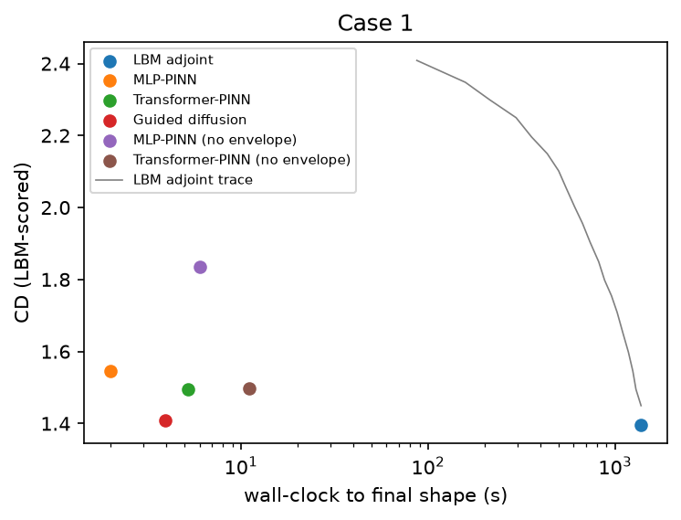
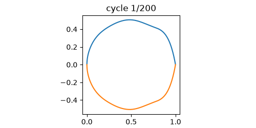
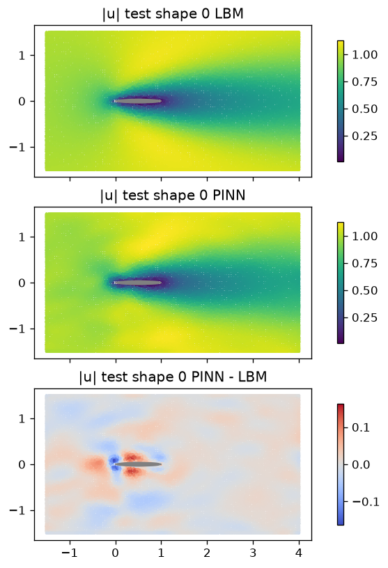

# aeroshape: differentiable aerodynamic shape optimisation

A 2D airfoil shape optimiser in PyTorch that runs on Apple Metal (MPS), NVIDIA CUDA and CPU. A NURBS shape (control points $\alpha$) feeds three solver tiers, and they are benchmarked against each other:

1. **Lattice Boltzmann + discrete adjoint.** This is the classical ground truth: a D2Q9 solver with Bouzidi interpolated bounce-back, so the gradient sees the curved wall, plus a hand-derived adjoint for $\nabla_\alpha C_D$.
2. **Physics-informed surrogates.** A Transformer PINN, where every flow point cross-attends to the control-point tokens, with a Fourier-feature MLP PINN as the baseline. Both output a stream function, so the flow is divergence-free by construction.
3. **Physics-guided diffusion.** A DDIM model over shapes that generates an airfoil for a target $[C_L, C_D, \mathrm{Re}, \mathrm{AoA}]$. The frozen PINN's gradients steer each denoising step.

Every method's final shape is re-scored by the LBM, so no method is judged by its own drag number.

**The maths:** [`docs/equations.md`](docs/equations.md) covers NURBS, LBM, Bouzidi IBB, adjoint, PINN loss, guided diffusion and the augmented Lagrangian, all written out.

<p align="center">
  
  
  
</p>
<p align="center"><sub>Case 1, circle → low-drag airfoil at Re 20. Left: LBM adjoint, 20 cycles. Middle: Transformer PINN with the training-box envelope. Right: guided diffusion denoising, 50 DDIM steps.</sub></p>

---

## Results

All numbers are measured on an Apple M4 Pro (MPS) at the `dev` tier unless stated. Nothing here is a projection.

### Case 1: circle → NACA0012-like, Re 20, AoA 0

The start shape is a circle with $C_D = 2.409$. The thickness constraint comes from the target airfoil.

| Method | $C_D$ (LBM re-score) | Drag reduction | Wall-clock to final shape | Up-front training |
|---|---|---|---|---|
| LBM adjoint | 1.396 | **42.1%** | 1376 s (20-cycle cap, still descending) | none |
| Guided diffusion | 1.408 | 41.6% | **3.9 s** | 13,389 s |
| Transformer PINN (training-box envelope) | 1.494 | 38.0% | 5.2 s | 13,017 s |
| MLP PINN (training-box envelope) | 1.547 | 35.8% | 2.0 s | 2,622 s |
| MLP PINN (no envelope) | 1.835 | 23.8% | 6.0 s | 2,622 s |

<p align="center">
  
  
</p>

**Finding:** surrogates exploit their own error. Left unconstrained, the MLP PINN optimiser reported $C_D = 0.07$ for a shape the LBM scores at 1.84.

<p align="center">
  
</p>

- **The envelope:** clamping $\alpha$ to the training-data box fixes most of the error, but not all of it. Inside the box, the Transformer's own $C_D$ is still −0.71.
- **Diffusion:** it avoids the problem because its samples stay on the data manifold.

### Solver validation

| Check | Target | Measured |
|---|---|---|
| Cylinder $C_D$, Re 20 (Dennis & Chang 2.045) | within 2% | 2.058 (+0.86% vs the report's 2.04) |
| Cylinder $C_D$, Re 40 (Nieuwstadt & Keller 1.550) | within 2% | −0.94% |
| Cylinder mean $C_D$, Re 100 (report 1.365) | within 2% | 1.384 (+1.39%), vortex street |
| Adjoint vs central differences, 41 control points, float64 | rel. $L_2$ < $2\times10^{-3}$ | $3.2\times10^{-4}$ |

<p align="center">
  
  
</p>

### Surrogates

| Model | Regime | Velocity $L_2$ error | $C_D$ error | $\nabla_\alpha C_D$ cosine vs adjoint | Query latency ($C_D$ + gradient) |
|---|---|---|---|---|---|
| Transformer PINN | Re 20 steady, 10 held-out shapes | 1.47% | 1.33% | 0.970 | 57 ms |
| MLP PINN | Re 20 steady | 2.29% | 1.32% | 0.949 | 17 ms |
| Transformer PINN v2 | Re 1000 time-averaged, AoA 0 / 10 | 3.7% / 2.3% | 15.3% / 9.7% | 0.34 (3 runs) | 58 ms |
| MLP PINN v2 | Re 1000 time-averaged, AoA 0 / 10 | 5.3% / 4.0% | 10.8% / 16.6% | 0.32 (3 runs) | 17 ms |

- **Speed:** a Transformer drag + gradient query is about 1270× faster than one adjoint-LBM solve at Re 20.
- **Latency target missed:** the original "< 2 ms" target was not met.
- **Re 1000:** the surrogates fit the time-averaged fields but not the drag sensitivity. Read the Re 1000 gradient cosine as a weak signal: it rests on 3 runs, against an approximate time-averaged adjoint.

<p align="center">
  
  
</p>
<p align="center"><sub>Left: speed magnitude on a held-out shape, LBM vs Transformer PINN and their difference. Right: how much the flow points attend to each control-point token; the last token is the Re/AoA condition.</sub></p>

### Status

| Item | State |
|---|---|
| Geometry, LBM, adjoint, dataset | done; Gates 1, 2a and 2b passed |
| PINN surrogates, Re 20 | done; Gate 3 passed |
| Diffusion, Case 1 benchmark | done |
| PINN v2 (Re 1000 time-averaged) | trained, with a coverage set for the Case 2 start shape |
| Cases 2–3 (Re 1000, circle/NACA → RAE2822) | **not run yet**; they need the cambered diffusion model |
| CUDA verification on a cloud GPU | not run yet (`scripts/cuda_check.sh`) |

---

## Quick start

```bash
uv sync --extra dev                                    # Python 3.12, PyTorch 2.x
uv run pytest -q                                       # fast tests (about 5 min on an M4 Pro)
uv run python scripts/00_smoke_e2e.py --device mps     # whole pipeline at smoke tier
```

The device order is CUDA → MPS → CPU, and `AEROSHAPE_DEVICE` overrides it. The code uses float32 on GPUs and float64 on CPU for gradient checks; MPS has no float64.

Full pipeline (`--tier smoke|dev|full`):

```bash
uv run python scripts/01_validate_lbm_cylinder.py --tier dev --device mps            # Table 1 cylinder validation
uv run python scripts/02_generate_lbm_dataset.py --set v1 --tier dev --device mps    # LBM anchor dataset
uv run python scripts/02_generate_lbm_dataset.py --set v1 --tier dev --merge
uv run python scripts/03_train_transformer_pinn.py --model transformer --tier dev --device mps --out runs/pinn_transformer
uv run python scripts/04_train_diffusion_model.py --tier dev --device mps --out runs/diffusion_dev
uv run python scripts/05_run_4way_benchmark.py --tier dev --device mps --cases 1
uv run python scripts/07_make_figures.py                                              # figures -> runs/figures/
```

The benchmark reads trained checkpoints from `runs/pinn_selected.json`. Datasets, runs and weights are not in the repository.

Docker: [`docker/README.md`](docker/README.md). Colab/CUDA: [`notebooks/colab_cuda.ipynb`](notebooks/colab_cuda.ipynb).

## Layout

```text
src/aeroshape/
  geometry/       NURBS airfoil, reference shapes (NACA, RAE2822), grid mapper + Bouzidi link fractions
  lbm/            D2Q9 solver (BGK/TRT), momentum-exchange forces, discrete adjoint
  pinn/           MLP and Transformer PINNs, Navier–Stokes loss, sampling, stress integrator
  diffusion/      cosine schedule, Transformer denoiser, PINN-guided DDIM sampler
  optimization/   evaluators (adjoint LBM / PINN) and the augmented-Lagrangian optimiser
  visualization/  plots and animations
scripts/          numbered pipeline stages 00–07
configs/          base.yaml, tiers/{smoke,dev,full}.yaml, one YAML per test case
tests/            mirrors src/; every gradient has a float64 finite-difference test
docs/             equations.md and README figures
Plan/             the full design spec, decisions log (G1–G40) and risk register
```

## Design rules

- **Differentiability:** everything from $\alpha$ to drag stays differentiable, with no `.item()` or Python loops over lattice nodes inside solvers and losses.
- **Per-point derivatives:** PINN flow points never attend to each other, so one `autograd.grad` call gives exact per-point derivatives.
- **Gradient tests:** every gradient (adjoint, PINN, NURBS, link fraction $q$) has a float64 finite-difference test.
- **Scoring:** every benchmark shape is re-scored by the LBM, and only measured numbers are reported.

## References

- Bouzidi, Firdaouss, Lallemand (2001), *Momentum transfer of a Boltzmann-lattice fluid with boundaries*.
- Krüger et al. (2017), *The Lattice Boltzmann Method: Principles and Practice*.
- Raissi, Perdikaris, Karniadakis (2019), *Physics-informed neural networks*.
- Nichol and Dhariwal (2021), *Improved denoising diffusion probabilistic models*.
- Song, Meng, Ermon (2021), *Denoising diffusion implicit models*.
