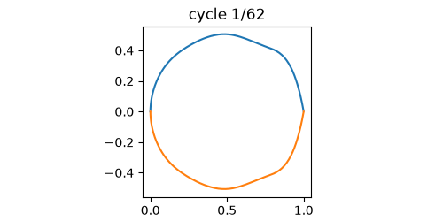
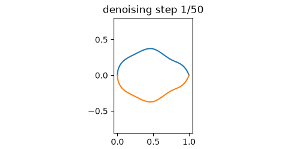
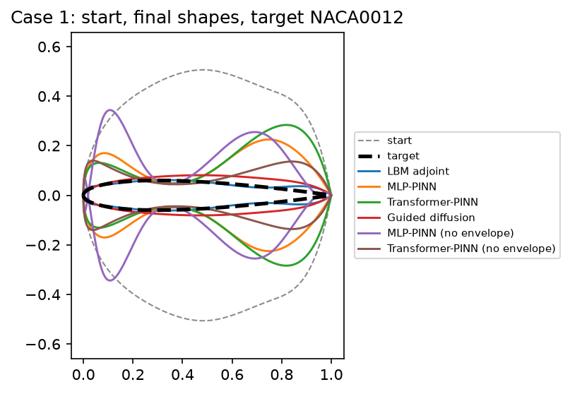
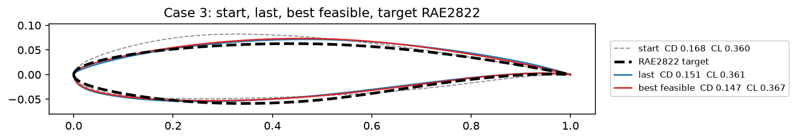
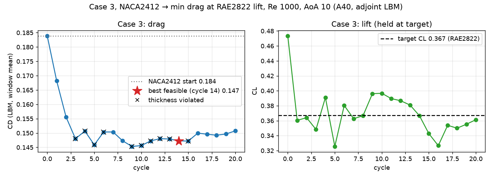
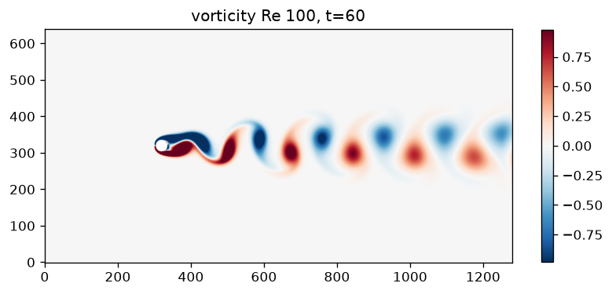
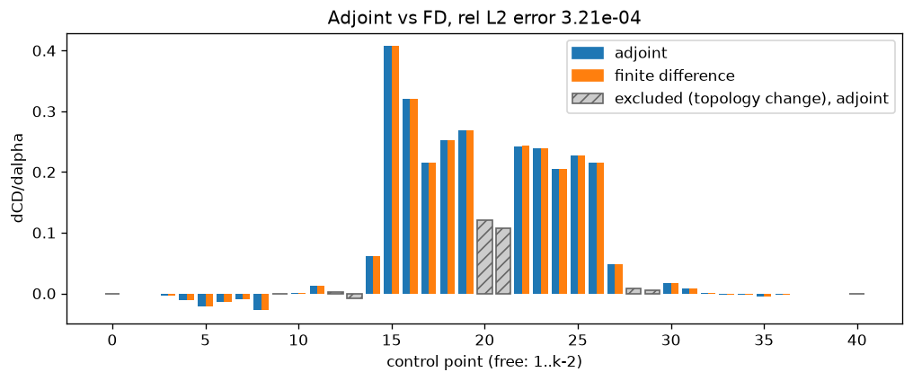
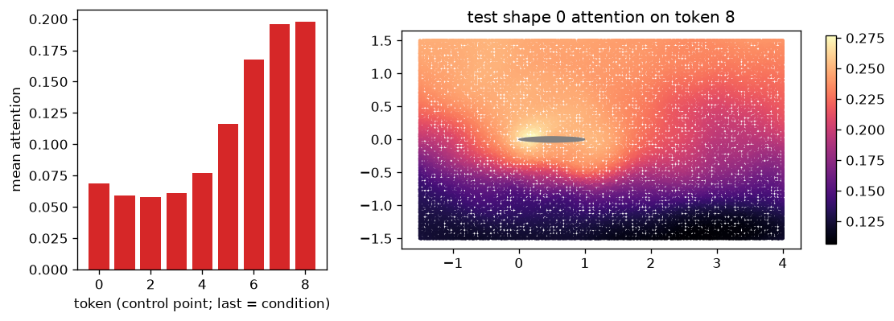

# aeroshape: differentiable aerodynamic shape optimisation

A 2D airfoil shape optimiser in PyTorch that runs on Apple Metal (MPS), NVIDIA CUDA and CPU. A NURBS shape (control points $\alpha$) feeds three solver tiers, and they are benchmarked against each other:

1. **Lattice Boltzmann + discrete adjoint.** This is the classical ground truth: a D2Q9 solver with Bouzidi interpolated bounce-back, so the gradient sees the curved wall, plus a hand-derived adjoint for $\nabla_\alpha C_D$.
2. **Physics-informed surrogates.** A Transformer PINN, where every flow point cross-attends to the control-point tokens, with a Fourier-feature MLP PINN as the baseline. Both output a stream function, so the flow is divergence-free by construction.
3. **Physics-guided diffusion.** A DDIM model over shapes that generates an airfoil for a target $[C_L, C_D, \mathrm{Re}, \mathrm{AoA}]$. The frozen PINN's gradients steer each denoising step.

Every method's final shape is re-scored by the LBM, so no method is judged by its own drag number.

**The maths:** [`docs/equations.md`](docs/equations.md) covers NURBS, LBM, Bouzidi IBB, adjoint, PINN loss, guided diffusion and the augmented Lagrangian, all written out.

<p align="center">
  
  
  
</p>
<p align="center"><sub>Case 1, circle → low-drag airfoil at Re 20. Left: LBM adjoint, 51 cycles to convergence. Middle: Transformer PINN with the training-box envelope. Right: guided diffusion denoising, 50 DDIM steps.</sub></p>

---

## Results

All numbers are measured at the `dev` tier, on an Apple M4 Pro (MPS) or a RunPod NVIDIA A40 (CUDA) as stated. Nothing here is a projection.

### Case 1: circle → NACA0012-like, Re 20, AoA 0

The start shape is a circle with $C_D = 2.409$. The thickness constraint comes from the target airfoil.

Run on the A40 (`runs/benchmark/dev_c1v2`). The LBM adjoint stopped on its own convergence test (`cd_stalled`) after 51 cycles.

| Method | $C_D$ (LBM re-score) | Drag reduction | Distance to NACA0012 | Wall-clock to final shape | Up-front training |
|---|---|---|---|---|---|
| LBM adjoint | **1.135** | **52.9%** | **0.0085** | 8757 s (51 cycles) | none |
| Guided diffusion | 1.181 | 51.0% | 0.0196 | **4.2 s** | 13,389 s |
| MLP PINN (training-box envelope) | 1.547 | 35.8% | 0.0951 | 9.6 s | 2,622 s |
| Transformer PINN (training-box envelope) | 1.637 | 32.0% | 0.1191 | 57.6 s | 13,017 s |
| Transformer PINN (no envelope) | 1.355 | 43.7% | 0.0660 | 330.6 s | 13,017 s |
| MLP PINN (no envelope) | 1.858 | 22.9% | 0.1280 | 192.6 s | 2,622 s |

<p align="center">
  
  
</p>

**Finding:** surrogates exploit their own error. Left unconstrained, the MLP PINN optimiser reported $C_D = 0.011$ for a shape the LBM scores at 1.86.

<p align="center">
  
</p>

- **The envelope:** clamping $\alpha$ to the training-data box fixes most of the error, but not all of it. Inside the box, the Transformer's own $C_D$ is still −1.83.
- **Diffusion:** it avoids the problem because its samples stay on the data manifold.

### Case 3: NACA2412 → minimum drag at RAE2822 lift, Re 1000, AoA 10

Objective: minimise $C_D$ with $C_L$ held at the LBM value of RAE2822 (0.367) and thickness at least RAE2822's. RAE2822 is a check, not the goal. LBM adjoint on the A40, 20 cycles (`runs/benchmark/dev/case3_adjoint_lbm`).

| | $C_D$ | $C_L$ | Thickness violation | Distance to RAE2822 |
|---|---|---|---|---|
| NACA2412 start | 0.184 | 0.473 | – | – |
| Best feasible shape (cycle 14) | **0.147** (−20%) | 0.367 | 0 | 0.0051 |

<p align="center">
  
  
</p>

- Drag falls in the first 3 cycles, then holds at 0.145–0.151 while lift oscillates about ±0.04 around the target. The run stopped at its 20-cycle cap, not on a convergence test.
- The "start" curve in the shape plot is this run's start: the best shape of an earlier run (cycle 2, $C_D$ 0.168).

**Case 3 benchmark** (all shapes re-scored by the LBM; drag reduction is against the driver's first cycle, $C_D$ 0.168; target $C_L$ 0.367):

| Method | $C_D$ (LBM) | $C_L$ (LBM) | Distance to RAE2822 | Wall-clock |
|---|---|---|---|---|
| LBM adjoint | **0.147** | 0.367 | **0.0051** | 6596 s (A40) |
| Transformer PINN (no envelope) | 0.159 | 0.361 | 0.0267 | 63 s |
| Transformer PINN (training-box envelope) | 0.165 | 0.422 | 0.0148 | 59 s |
| Guided diffusion | 0.173 | 0.335 | 0.0102 | **4.0 s** |
| MLP PINN (training-box envelope) | 0.633 | 1.120 | 0.0857 | 26 s |
| MLP PINN (no envelope) | 0.830 | 1.236 | 0.0897 | 31 s |

- The LBM adjoint wins on both drag and lift. The Transformer PINN gets within 8% of its drag in about 1% of the time; the MLP PINN fails at Re 1000 (its shapes more than quadruple the drag).
- A hybrid row (PINN gradient, LBM line search) was started and stopped at cycle 9 ($C_D$ ≈ 0.157) to free the GPU for the gate; it is not in the table.

### Case 2: circle → RAE2822, Re 1000 (partial)

The time-averaged adjoint gives a usable gradient on the Case 3 airfoil (cosine 0.92 against window-mean finite differences) but not on the separated blob of Case 2 (cosine −0.13; MPS and CUDA agree), so the earlier Case 2 run never left the blob. Case 2 therefore uses a finite-difference gradient (`--evaluator fd_lbm`, $1 + 2n$ LBM solves per cycle; `05 --fd-cases 2`). Details: decision G42 in `Plan/raw/gaps_and_decisions.md`; check script `scripts/09_check_re1000_gradient.py`.

- **The finite-difference gradient works:** drag fell 1.402 → 1.250 → 1.174 in 3 cycles (−16%). One cycle costs about 40 min on the A40, so a converged run (about 16+ cycles) needs 12–20 GPU hours; the run was stopped after 3 cycles (G43).
- None of the 3 cycles met the lift constraint (target $C_L$ −0.043; cycle 3 has 0.040), so the best-point rule (feasible points first, then smallest lift error) keeps the start, and that is what the table re-scores.

| Method | $C_D$ (LBM) | $C_L$ (LBM) | Lift error | Distance to RAE2822 | Wall-clock |
|---|---|---|---|---|---|
| LBM finite-difference gradient (3 cycles, start re-scored) | 1.402 | −0.026 | 0.017 | 0.285 | 9552 s (A40) |
| Guided diffusion | 1.424 | 0.035 | 0.078 | 0.275 | 4.0 s |
| Transformer PINN (training-box envelope) | 0.333 | −0.370 | 0.327 | 0.087 | 15 s |
| Transformer PINN (no envelope) | 0.454 | −0.405 | 0.362 | 0.109 | 19 s |
| MLP PINN (training-box envelope) | 0.569 | −0.925 | 0.883 | 0.091 | 6 s |
| MLP PINN (no envelope) | 0.762 | −0.530 | 0.487 | 0.108 | 7 s |

- The PINN rows thin the blob into much closer airfoil shapes with far lower LBM drag, but miss the lift target by 0.33–0.88, so none is a feasible answer to the constrained problem. They show what a fast surrogate can do as a starting point; a finite-difference or adjoint LBM run from a PINN shape is the obvious next step.

### Solver validation

| Check | Target | Measured |
|---|---|---|
| Cylinder $C_D$, Re 20 (Dennis & Chang 2.045) | within 2% | 2.058 (+0.86% vs the report's 2.04) |
| Cylinder $C_D$, Re 40 (Nieuwstadt & Keller 1.550) | within 2% | −0.94% |
| Cylinder mean $C_D$, Re 100 (report 1.365) | within 2% | 1.384 (+1.39%), vortex street |
| Adjoint vs central differences, 41 control points, float64 | rel. $L_2$ < $2\times10^{-3}$ | $3.2\times10^{-4}$ |

<p align="center">
  
  
</p>

### Surrogates

| Model | Regime | Velocity $L_2$ error | $C_D$ error | $\nabla_\alpha C_D$ cosine vs adjoint | Query latency ($C_D$ + gradient) |
|---|---|---|---|---|---|
| Transformer PINN | Re 20 steady, 10 held-out shapes | 1.47% | 1.33% | 0.970 | 57 ms |
| MLP PINN | Re 20 steady | 2.29% | 1.32% | 0.949 | 17 ms |
| Transformer PINN v2 | Re 1000 time-averaged, AoA 0 / 10 | 3.7% / 2.3% | 15.3% / 9.7% | 0.34 (3 runs) | 58 ms |
| MLP PINN v2 | Re 1000 time-averaged, AoA 0 / 10 | 5.3% / 4.0% | 10.8% / 16.6% | 0.32 (3 runs) | 17 ms |

- **Speed:** a Transformer drag + gradient query is about 1270× faster than one adjoint-LBM solve at Re 20.
- **Latency target missed:** the original "< 2 ms" target was not met.
- **Re 1000:** the surrogates fit the time-averaged fields but not the drag sensitivity. Read the Re 1000 gradient cosine as a weak signal: it rests on 3 runs, against an approximate time-averaged adjoint.

<p align="center">
  
  
</p>
<p align="center"><sub>Left: speed magnitude on a held-out shape, LBM vs Transformer PINN and their difference. Right: how much the flow points attend to each control-point token; the last token is the Re/AoA condition.</sub></p>

### Status

| Item | State |
|---|---|
| Geometry, LBM, adjoint, dataset | done; Gates 1, 2a and 2b passed |
| PINN surrogates, Re 20 | done; Gate 3 passed |
| Diffusion, Case 1 benchmark | done |
| PINN v2 (Re 1000 time-averaged) | trained, with a coverage set for the Case 2 start shape |
| Case 3 (Re 1000, NACA2412 → RAE2822) | done: LBM adjoint −20% $C_D$ at target $C_L$; PINN and diffusion rows in the table |
| Case 2 (Re 1000, circle → RAE2822) | partial: adjoint unusable on the blob; finite-difference gradient −16% $C_D$ in 3 cycles, not converged (12–20 GPU h needed) |
| Smoke e2e | passes on CPU, MPS (111 s) and CUDA A40 (142 s); summaries within tolerance of the reference |
| CUDA tests | 3 failures in the opt-in `torch.compile` / CUDA-graph tests (`tests/lbm/test_accel.py`); the full suite was too slow to finish on the pod's CPU |
| Gate 4 | **passed with documented exceptions** (Case 2 partial, CUDA-graph tests); see G43 |

---

## Quick start

```bash
uv sync --extra dev                                    # Python 3.12, PyTorch 2.x
uv run pytest -q                                       # fast tests (about 5 min on an M4 Pro)
uv run python scripts/00_smoke_e2e.py --device mps     # whole pipeline at smoke tier
```

The device order is CUDA → MPS → CPU, and `AEROSHAPE_DEVICE` overrides it. The code uses float32 on GPUs and float64 on CPU for gradient checks; MPS has no float64.

Full pipeline (`--tier smoke|dev|full`):

```bash
uv run python scripts/01_validate_lbm_cylinder.py --tier dev --device mps            # Table 1 cylinder validation
uv run python scripts/02_generate_lbm_dataset.py --set v1 --tier dev --device mps    # LBM anchor dataset
uv run python scripts/02_generate_lbm_dataset.py --set v1 --tier dev --merge
uv run python scripts/03_train_transformer_pinn.py --model transformer --tier dev --device mps --out runs/pinn_transformer
uv run python scripts/04_train_diffusion_model.py --tier dev --device mps --out runs/diffusion_dev
uv run python scripts/05_run_4way_benchmark.py --tier dev --device mps --cases 1
uv run python scripts/07_make_figures.py                                              # figures -> runs/figures/
```

The benchmark reads trained checkpoints from `runs/pinn_selected.json`. Datasets, runs and weights are not in the repository.

Docker: [`docker/README.md`](docker/README.md). Colab/CUDA: [`notebooks/colab_cuda.ipynb`](notebooks/colab_cuda.ipynb).

## Layout

```text
src/aeroshape/
  geometry/       NURBS airfoil, reference shapes (NACA, RAE2822), grid mapper + Bouzidi link fractions
  lbm/            D2Q9 solver (BGK/TRT), momentum-exchange forces, discrete adjoint
  pinn/           MLP and Transformer PINNs, Navier–Stokes loss, sampling, stress integrator
  diffusion/      cosine schedule, Transformer denoiser, PINN-guided DDIM sampler
  optimization/   evaluators (adjoint LBM / PINN) and the augmented-Lagrangian optimiser
  visualization/  plots and animations
scripts/          numbered pipeline stages 00–07
configs/          base.yaml, tiers/{smoke,dev,full}.yaml, one YAML per test case
tests/            mirrors src/; every gradient has a float64 finite-difference test
docs/             equations.md and README figures
Plan/             the full design spec, decisions log (G1–G40) and risk register
```

## Design rules

- **Differentiability:** everything from $\alpha$ to drag stays differentiable, with no `.item()` or Python loops over lattice nodes inside solvers and losses.
- **Per-point derivatives:** PINN flow points never attend to each other, so one `autograd.grad` call gives exact per-point derivatives.
- **Gradient tests:** every gradient (adjoint, PINN, NURBS, link fraction $q$) has a float64 finite-difference test.
- **Scoring:** every benchmark shape is re-scored by the LBM, and only measured numbers are reported.

## References

- Bouzidi, Firdaouss, Lallemand (2001), *Momentum transfer of a Boltzmann-lattice fluid with boundaries*.
- Krüger et al. (2017), *The Lattice Boltzmann Method: Principles and Practice*.
- Raissi, Perdikaris, Karniadakis (2019), *Physics-informed neural networks*.
- Nichol and Dhariwal (2021), *Improved denoising diffusion probabilistic models*.
- Song, Meng, Ermon (2021), *Denoising diffusion implicit models*.
